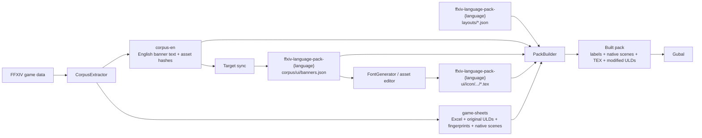

# Banner textures, translations and ULD layouts

Banner text, banner images and interface layouts are separate inputs. PackBuilder combines them
into the pack that Gubal loads. Paths below are relative to the named repository or output folder.

## LP reviewer responsibilities

**LP reviewer** marks the work required for a language review. The other material describes file
formats and shared tooling for reference.

| Review | Reviewer task |
|---|---|
| [Banner wording](#banner-text-what-to-translate) | Edit or approve the LP's `target`, using the glossary and text corpus. Preserve keys, hashes and headers. |
| [Banner image](#banner-images-where-to-put-the-translation) | Compare Original and Translation. Check wording, font, accents, spacing, halo, clipping and line breaks. Confirm that the image matches `target`. |
| [Interface layout](#uld-layouts-where-to-put-interface-adjustments) | Check that translated text fits at the normal game size. Report clipping, overlap or unsuitable font sizes with the affected screen or banner ID. |
| [In-game review](#lp-reviewer-local-build-and-visual-review) | Load the test pack, check both banner versions in Dev, and check the affected interface in its normal game context. |

The LP asset maintainer generates or edits TEX images and prepares ULD patches from this feedback.
Source extraction, game-sheet exports and native scene mappings are shared maintenance tasks.
Report missing English text or a missing native preview mapping to the shared maintainer.

## Where each file belongs

| Location | File | Purpose | Maintained by |
|---|---|---|---|
| `ffxiv-corpus-en/` | `corpus/ui/banners.json` | English banner text, texture keys and original asset hashes | Source sync; reviewed transcriptions |
| `ffxiv-game-sheets/` | `metadata/banner-native-scenes.json` | Shared native preview configuration for every LP | Game-sheet export; reviewed manual mappings |
| `ffxiv-language-pack-<language>/` | `corpus/ui/banners.json` | Translated banner text in `target` | Target sync; translators |
| `ffxiv-language-pack-<language>/` | `ui/icon/<folder>/en/<id>.tex` | Translated normal-resolution image | FontGenerator or an asset editor |
| `ffxiv-language-pack-<language>/` | `ui/icon/<folder>/en/<id>_hr1.tex` | Translated HD image | FontGenerator or an asset editor |
| `ffxiv-language-pack-<language>/` | `layouts/<name>.json` | Font-size and position changes for one ULD | LP maintainers |
| `ffxiv-game-sheets/` | `ui/uld/<name>.uld` | Original ULD bytes for builds without the game installed | Game-sheet export |
| `ffxiv-game-sheets/` | `original-fingerprints.json` | Original TEX, font and ULD fingerprints | Game-sheet export |
| Built pack | `dev/banner-translations.json` | Combined English and translated labels for Gubal Dev | PackBuilder |
| Built pack | `dev/banner-native-scenes.json` | Copy of the shared native preview configuration | PackBuilder |
| Built pack | `ui/icon/.../*.tex` | Copies of the LP's translated images | PackBuilder |
| Built pack | `ui/uld/<name>.uld` | Original ULD with the LP's JSON changes applied | PackBuilder |

`ffxiv-corpus-en` stores banner text and original asset hashes. Game-sheets stores the shared preview
configuration in `metadata/`. LP layout patches stay in `layouts/`. Original TEX images and ULD binaries
come from the game. The sheet export stores required original ULD binaries and TEX fingerprints,
but does not store original TEX images.



For a local build, PackBuilder can read original resources directly from the installed game instead
of `ffxiv-game-sheets`. It still reads native scene metadata from the directory set by
`[CorpusExtractor] sheets` in `tools.ini`. A build from exported sheets reads metadata from that export.
Output paths come from `tools.ini`.

## Banner text: what to translate

**LP reviewer:** edit or approve the translated wording in this file.

Open **`ffxiv-language-pack-<language>/corpus/ui/banners.json`**. Edit `target`; preserve `gameKey`
and `hash`. Keep one entry per physical line, ordered by texture ID, in both source and target.
Target sync creates missing rows with an empty `target`.

English source, **`ffxiv-corpus-en/corpus/ui/banners.json`**:

```json
{
  "schemaVersion": 3,
  "sourceLanguage": "en",
  "gameVersion": "2026.10.16.0000.0000",
  "conversation": "ui/banners",
  "entries": [
    {"gameKey":"ui/icon/120000/en/120001.tex#text","en":"Quest Accepted","hash":"366959CD1710B78D"}
  ]
}
```

Matching translation, **`ffxiv-language-pack-es-es/corpus/ui/banners.json`**:

```json
{
  "gameVersion": "2026.10.16.0000.0000",
  "conversation": "ui/banners",
  "entries": [
    {"gameKey":"ui/icon/120000/en/120001.tex#text","hash":"366959CD1710B78D","target":"Misión aceptada"}
  ]
}
```

The texture path inside `gameKey` identifies the original game resource, followed by `#text`.
It is not the path of another corpus JSON file. All banner rows stay in `corpus/ui/banners.json`.
Version and file identity stay in the header; banner rows do not carry dialogue metadata.

| Value or file | Meaning |
|---|---|
| Empty `en` | No English text has been transcribed; the image can also contain no text |
| Empty `target` | No translation is recorded |
| Filled `target`, no translated TEX pair | The wording is recorded; the translated image is still missing |
| Filled `target` and translated TEX pair | The text and images are available for visual review |

**Writing `target` does not change the image.** Generate or edit the TEX pair separately and put it
in the LP. Use the glossary and text corpus for agreed terms. Keep the image and `target` consistent.
See [FontGenerator](https://github.com/ashdam/corpus-extractor/tree/main/fontgenerator) for fonts,
glyphs, rendering and installation commands.

The banner hash covers the original normal and HD TEX bytes. A change to either image changes the
hash; editing `en` does not. Source sync calculates it. Do not use a hash of the wording.
Target sync preserves translated rows and their hashes so changed originals remain detectable.

## Banner images: where to put the translation

**LP reviewer:** approve the rendered image, including typography and fit. Report defects to the LP
asset maintainer; filling `target` alone does not complete image review.

For texture `120001`, the LP must contain both images:

```text
ffxiv-language-pack-<language>/
  corpus/ui/banners.json
  ui/icon/120000/en/120001.tex
  ui/icon/120000/en/120001_hr1.tex
```

Use `en` in the image path for every LP language. Gubal serves translated resources in the game's
English slot. Keep the original path, ID and canvas dimensions.

| Requirement | Value |
|---|---|
| Supported translated image folders | `120000/en`, `121000/en`, `122000/en`, `123000/en`, `124000/en`, `126000/en`, `127000/en`, `128000/en`, `129000/en`, `180000/en`, `181000/en` |
| Filenames | `<id>.tex` and `<id>_hr1.tex`; the ID starts with the folder's first three digits |
| Pixel format | Uncompressed BGRA, TEX format `0x1450` |
| HD size | Twice the normal width and height |
| TEX structure | 80-byte header, one depth slice, one mip level, pixels starting at byte 80 |

The source inventory includes IDs from `120000` through `129999`; translated image support uses the
narrower folder list above. Keep PNG, XCF and preview files outside the LP's `ui/icon/`.
PackBuilder validates TEX pairs and copies them to the same paths in the built pack.

## ULD layouts: where to put interface adjustments

**LP reviewer:** check the translated interface in game and identify any required size or position
adjustments. The LP maintainer prepares and validates the patch below.

A ULD defines interface layout. Its JSON patch changes text-node font sizes or positions; it does
not translate words. Translate those words in the matching text sheet under the LP's `corpus/`.

There is no ULD translation file in `ffxiv-corpus-en`. Put one patch per ULD in **the LP's `layouts/`**:

```text
ffxiv-language-pack-<language>/layouts/castbar.json   editable patch
ffxiv-game-sheets/ui/uld/castbar.uld                original for exported-sheet builds
<pack output>/ui/uld/castbar.uld                   generated, modified layout
```

Example LP patch:

```json
{
  "gamePath": "ui/uld/castbar.uld",
  "sourceSha256": "CA8DDAF29E2276F7476ABB0BBC7D3530D5FF075F58C2483C68B53A31F0353CAF",
  "nodes": [
    {"nodeId":6,"textId":1050,"expectedFontSize":12,"fontSize":10}
  ]
}
```

| Field | Requirement |
|---|---|
| `gamePath` | Original lowercase `ui/uld/<name>.uld` path; unique across the LP's patches |
| `sourceSha256` | SHA-256 of the complete original ULD bytes, 64 hexadecimal characters |
| `componentId` | Component containing the node; omit for a root-widget node |
| `nodeId`, `textId` | Expected text-node identifiers from the original ULD |
| `expectedFontSize`, `fontSize` | Original and replacement sizes, from 1 to 255; supply both and change the value |
| `expectedPosition`, `position` | Original and replacement coordinates relative to the parent, such as `{"x":20,"y":8}` |

Each node must change its size, position or both. Position objects must specify the same axes;
omit an axis to preserve it. Coordinates range from -32768 to 32767. A node may occur only once
within its component. Other ULD properties are not supported.

PackBuilder checks the original hash, node type, identifiers and expected values, then applies and
verifies the changes. After a game update, review changed originals before updating hashes or
expected values. Use the actual original's hash and node IDs, not values copied from an example.
The patch schema is [layout.schema.json](https://github.com/ashdam/corpus-extractor/blob/main/PackBuilder/schemas/layout.schema.json).

## LP reviewer: local build and visual review

Set the installed game, source corpus, LP and output paths in `tools.ini`. Run each command from
the directory containing its executable. Replace `it` with the target language. Use a test pack
provided by the LP maintainer, or build it locally with the following steps.

1. Use the synchronized LP and the TEX images or ULD patches prepared for review.
2. Build the local pack:

   ```powershell
   .\PackBuilder.exe --language it --skip-coverage --skip-zip
   ```

   This rebuilds the configured output without publishing or writing a ZIP. Originals come from
   the configured game source: the installed game or a matching game-sheet export.
3. Select the output folder as **Custom** in Gubal. In Dev, reload the list and compare Original
   with Translation. Move the Dev window aside if it covers the native banner. Restart the client
   to test normal game redirection of changed textures and ULDs.

## Shared and LP maintainer reference

These operations prepare the review inputs. They are not required reviewer tasks.

- Shared maintainer: run `CorpusExtractor.exe --sync-source` after a game update to update corpus-en,
  the native catalog and the configured game-sheet export.
- LP maintainer: run `CorpusExtractor.exe --language it --sync-target` to mirror source rows into the LP.
- LP asset maintainer: generate the TEX pairs and prepare any required `layouts/*.json` patches.
- For a new layout in an exported-sheet build, export its original from the installed game with
  `PackBuilder.exe --language it --export-layouts <game-sheets directory>`.

Check ULDs without a full pack build:

```powershell
.\PackBuilder.exe --language it --verify-layouts
.\PackBuilder.exe --language it --verify-pack-layouts <built folder or ZIP>
```

These checks use the LP's patches and original resources. Native preview configuration does not
affect whether a translated texture works in its normal game event.

### Native preview configuration

- **Source:** `ffxiv-game-sheets/metadata/banner-native-scenes.json`.
- **Built copy:** `<pack output>/dev/banner-native-scenes.json`.
- **LP source:** no separate copy is needed.

This file tells Gubal Dev how to request a banner through the game's native presentation system.
The game controls position, size and animation. Original and Translation use the same configuration;
the translated TEX files supply the replacement image.

| Field | Purpose |
|---|---|
| `gameVersion` | Game version required by the configuration |
| `scenes` | Resolved mappings, keyed by `textureId` |
| `type` and its parameters | Native request, such as a screen-image row or territory |
| `mode`, `index` | Exported native execution parameters |
| `images` | Textures expected in the displayed scene |
| `requestImages` | Textures used by the original request, before replacements |
| `manual: true` | Preserve this reviewed mapping during source sync; recalculate its execution parameters |
| `pendingTextureIds` | IDs without a resolved automatic or manual mapping |

Keep `images` and `requestImages` inline, and `_comment` immediately above `pendingTextureIds`.
An ID occurs in either `scenes` or `pendingTextureIds`. Pending IDs are not translation status.
They do not prove that each texture was investigated or that native preview is impossible.
Gubal Dev cannot preview them with this catalog yet.

Full sheet export calculates mappings from game sheets and tables read from the installed client
executable. Gubal reads this configuration; it does not calculate missing mappings. Native preview
requires the English client and a matching game version. Manual mappings require knowledge of the
native request; do not copy arbitrary parameters from another banner.

PackBuilder generates **`<pack output>/dev/banner-translations.json`** by joining English and LP
banner rows. It contains `gameKey`, `hash`, `en` and `target` for Gubal's list. Edit the LP's
`corpus/ui/banners.json` to change translations; the generated Dev file is build output.
